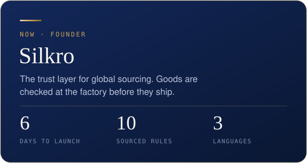
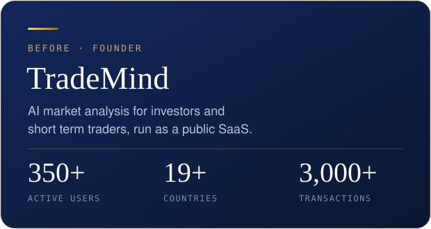

 

**18, from Uzbekistan, building in Shenzhen** next to the factories my product serves. I take products from idea to paying users: research, code, design, payments and distribution.

 

<table>
  <tr>
    <td width="50%" valign="top">
      
    </td>
    <td width="50%" valign="top">
      
    </td>
  </tr>
</table>

### Silkro &nbsp;·&nbsp; [silkro-wheat.vercel.app](https://silkro-wheat.vercel.app)

Before goods leave a factory in China, Silkro checks them and issues a **Verified Shipment**: what the product is, whether it matches the order and whether it can be sold where it is going. Started on 12 November 2026, live 6 days later.

- **Requirements map:** 10 sourced rules for the EU, US and Uzbekistan, shown as a 3D roadmap
- **Client dashboard:** shipments, Silkro Score, margins, CRM with Excel and Notion import
- **Document vault:** every file fingerprinted with SHA 256
- **Ask Silkro:** AI assistant with 5 agents, answering only from the client's own data
- **Built for three markets:** English, Russian and Uzbek, one language setting for site, app and email
- **Under the hood:** Postgres with row level security, 12 migrations, 48 passing tests

### TradeMind &nbsp;·&nbsp; [trademindtech.com](https://trademindtech.com) &nbsp;·&nbsp; [code](https://github.com/remvafin/trademind)

AI decision support for investors and short term traders: daily market bias, trade setups, a trading journal, backtesting and bias detection in one dashboard.

**350+** active users &nbsp;·&nbsp; **19+** countries (USA, Canada, Europe, Asia) &nbsp;·&nbsp; **3,000+** transactions logged

### Stack

`TypeScript` `Next.js` `React` `Python` `FastAPI` `PostgreSQL` `Supabase` `Three.js` `Tailwind` `Vercel` `Render` `Claude` `Gemini`

 

Based in Shenzhen &nbsp;·&nbsp; open to talk with founders, operators and investors in global trade
